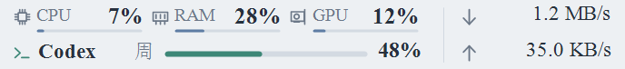
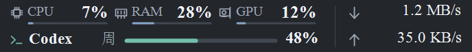

# Codex Taskbar Monitor

在 Windows 任务栏右侧查看 CPU、内存、GPU 使用率、实时下载／上传网速，以及 Codex 额度的**已用百分比**。

[下载最新 Windows x64 免安装包](https://github.com/GuangyaoYin/codex-taskbar-monitor/releases/latest)

浅色与深色界面。下图由程序绘制器生成，使用合成示例数据，不含私人账号信息。





## 功能

- 上行显示 CPU、物理内存和选中 GPU 的使用率；支持切换 GPU。
- 右侧双行显示下载、上传网速，每秒刷新并自动切换 B/s、KB/s、MB/s 等单位；悬停查看采集网卡。
- 下行显示 Codex 返回的额度周期和已用比例，例如周额度或 5 小时额度。未返回的周期不会被补成 0%。
- 悬停查看内存容量、GPU 名称与显存、额度重置时间及最后更新时间；时间按本机时区显示。
- 独立浮窗贴靠主屏任务栏通知区左侧，可拖动并记住位置；保留托盘入口和右键菜单。
- 正常情况下硬件与网速每秒刷新，额度每两分钟刷新。临时额度查询失败时保留并标记旧数据，按 15、30、60、120 秒恢复重试，详情显示下一次重试时刻。
- 开机启动默认关闭，可由用户自行开启。

v1.2 在等宽指标列、细线图标、进度条和圆角详情上增加了双向网速，随系统切换亮暗主题。中文使用宋体（SimSun），英文和数字使用 Times New Roman。

## 使用

1. 下载 Release 中的 `win-x64.zip`，解压后双击 `CodexTaskbarMonitor.exe`。无需安装 Python。
2. 如需查看额度，先安装官方 Codex，并使用自己的 ChatGPT 账号登录。可在菜单选择 Codex 程序路径、启动官方登录流程或手动刷新。
3. 将鼠标移到状态条查看详情；右键切换 GPU、设置启动项或退出。更完整的操作说明随压缩包提供。

本工具不捆绑 Codex CLI、账号或登录凭据。未安装或未登录 Codex 时，硬件监控仍可使用。它通过用户自己的官方 Codex App Server 读取额度，不创建对话或请求模型。

## 运行范围

- 面向 Windows 10/11 x64，使用 .NET Framework 4.6 或更新版本。
- 小窗是独立窗口，程序不嵌入或修改 Explorer。仅显示在主屏横向任务栏；全屏、任务栏自动隐藏或空白空间不足时收起，托盘入口仍可使用。
- NVIDIA 优先使用已安装驱动提供的 NVML，其他 GPU 使用 Windows 性能计数器。硬件或驱动不支持的指标显示 `--`。
- Codex 额度是否可用、返回哪些周期，取决于账号和官方 CLI。接口变化可能需要更新本工具。

已在开发机的 Windows 11 环境验证。Windows 10 已做标准任务栏尺寸的集成模拟，尚未完成 Windows 10 实机验证；不同显卡和任务栏布局仍需要实际使用反馈。

设置保存在 `%LOCALAPPDATA%\CodexTaskbarMonitor\settings.json`，包括位置、GPU 选择和手动指定的 Codex 路径。额度只在本次运行内存中缓存。

网速优先采集主联网物理接口，每次只统计一个接口，不将 VPN 与物理网卡重复相加；显示网卡层面的当前吞吐，包含协议开销。首次采样、切换接口或长时间暂停后重新建立基线，暂显示 `--`。

## 构建与验证

在 Windows PowerShell 中运行：

```powershell
powershell -NoProfile -ExecutionPolicy Bypass -File .\build.ps1
```

脚本使用系统的 .NET Framework x64 C# 编译器，生成 `release/CodexTaskbarMonitor-1.2.0-win-x64/` 和对应压缩包。代码使用 C# 5，无第三方 NuGet 依赖。

运行内置显示格式自检：

```powershell
$check = Start-Process .\release\CodexTaskbarMonitor-1.2.0-win-x64\CodexTaskbarMonitor.exe `
    -ArgumentList '--self-test' -Wait -PassThru
$check.ExitCode  # 0 表示通过
```

[`tools/UiIntegrationProbe.cs`](tools/UiIntegrationProbe.cs) 提供独立 UI 集成验证，使用合成数据检查尺寸、DPI、位置边界、详情、刷新状态和网速单位，并生成亮暗主题的绘制矩阵。网速边界测试在 [`tools/NetworkProbe.cs`](tools/NetworkProbe.cs)，额度接口与兼容性测试在 [`tools/CodexProbe.cs`](tools/CodexProbe.cs)。仓库示例图的生成代码见 [`docs/README-preview.cs`](docs/README-preview.cs)。

## English

A portable Windows 10/11 x64 utility for CPU, RAM, GPU usage, live download/upload speed and Codex quota **used percentages**. It shows a compact, theme-aware window beside the primary taskbar, with reset times in hover details and a tray menu. Codex quota reading requires your own official Codex installation and ChatGPT login; no CLI or credentials are bundled. Windows 10 support has been checked with simulated taskbar geometry and still needs validation on a physical Windows 10 machine.
